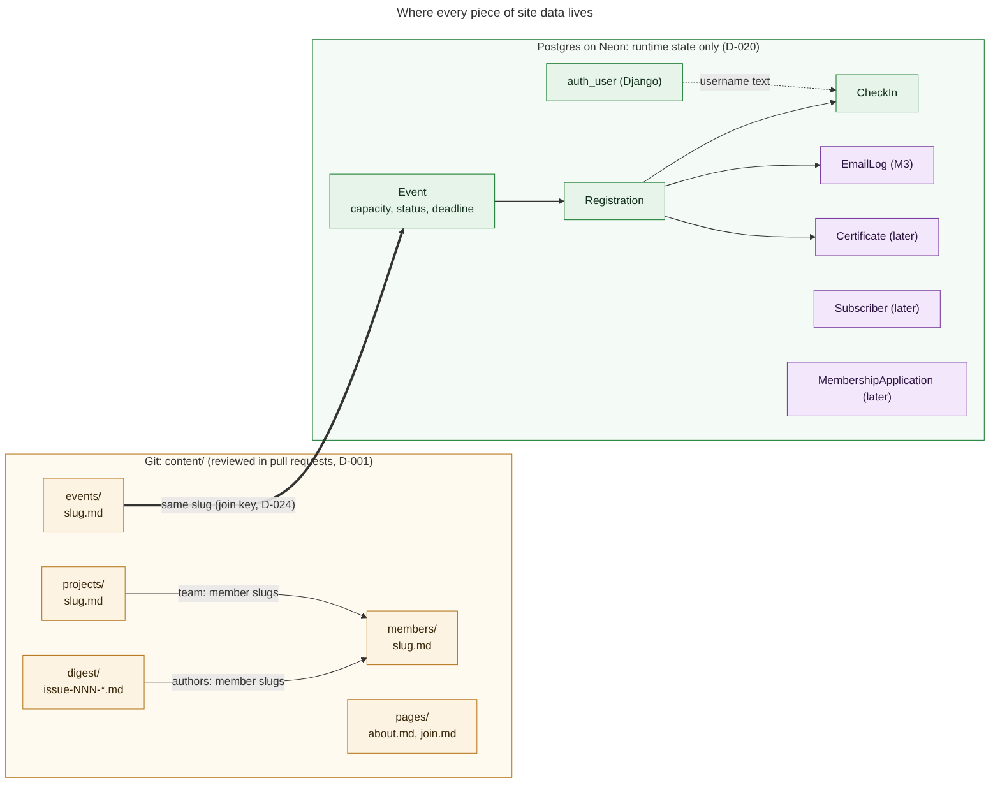
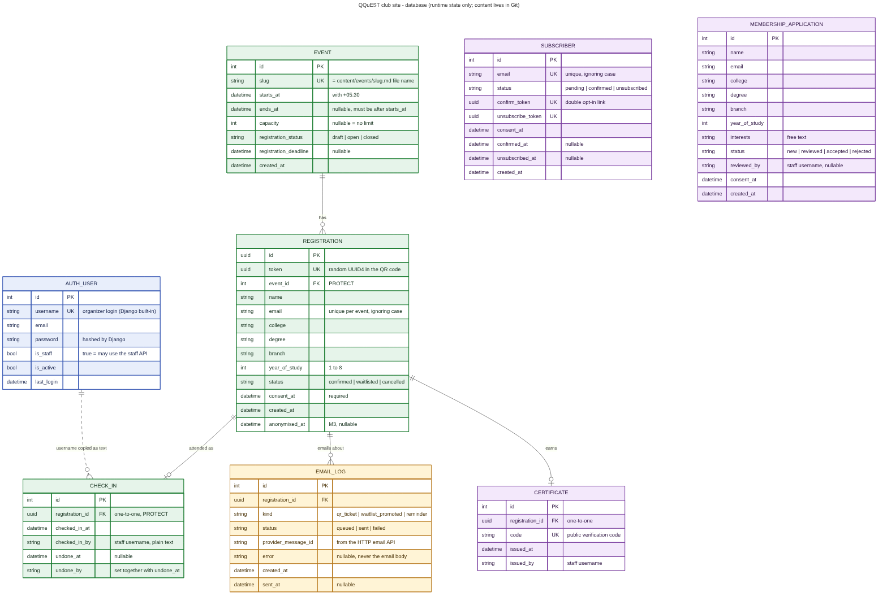
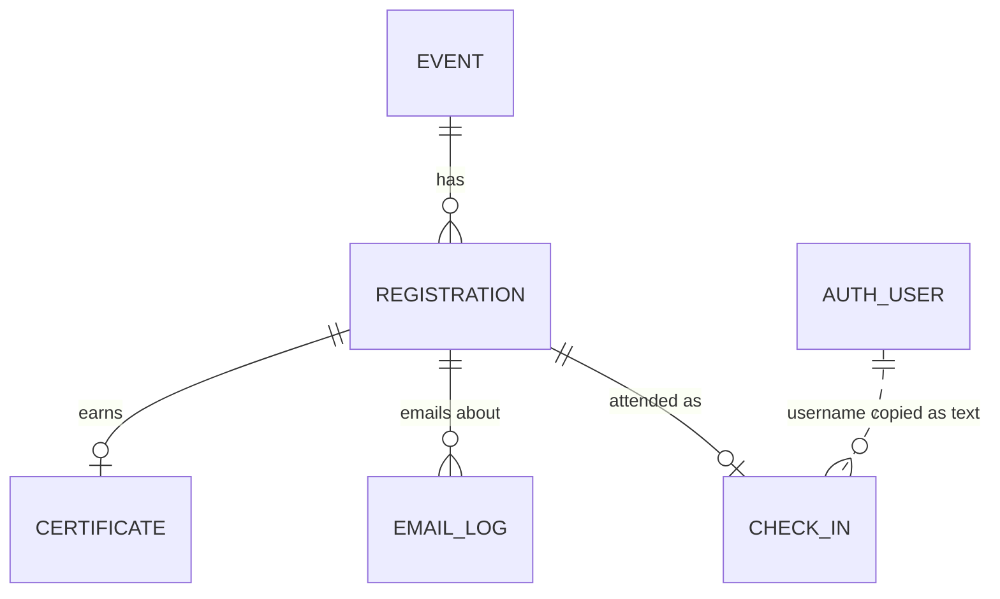

# Database design

The data design for the whole QQuEST club site: where data is stored, the built and proposed tables, and the built and proposed API routes. Use it as a design reference; `CONTRACT.md` and the models in `backend/apps/` remain authoritative for current behavior.

**One rule explains the design:** content lives in Git, runtime state lives in the database (D-001, D-024). Digest issues, events' descriptions, projects, members and pages are Markdown files reviewed in pull requests, so they are **not tables**. The database holds only what must change while people use the site: capacity, registrations, check-ins, and a few later features.

## 1. Where every piece of data lives

The only link between a Markdown event and its database row is the **slug** (`content/events/qff-2026.md` is `Event.slug = "qff-2026"`). Members are referenced by slug inside Markdown (digest `authors`, project `team`), never by a database id.

## 2. Tables

Colour key: **green** = represented by built backend models · **blue** = Django's own table · **amber** = planned for M3 · **purple** = later, not scheduled (needs a change proposal and a trigger from `spec/plan.md`).

Source of the pictures: [`erd.mmd`](erd.mmd) and [`data-map.mmd`](data-map.mmd). GitHub also draws the diagram below straight from the same source.

### 2.1 Built today (`backend/apps/`)

| Table (Django model) | Purpose | Key rules | Tests |
|---|---|---|---|
| `events_event` (`Event`) | Runtime side of an event: capacity, whether registration is open, deadline | `slug` unique and equal to the Markdown file name; `ends_at` after `starts_at` (check constraint); `draft` events are hidden from the public API | G-11, G-13, N-11 |
| `registrations_registration` (`Registration`) | One person's sign-up for one event | UUID primary key; separate random `token` for the QR code (never the id); unique on (event, lower(email)) = INV-6; `consent_at` required; event FK is `PROTECT` | G-12, N-09, INV-6-T |
| `registrations_checkin` (`CheckIn`) | The door log | one per registration; an undo keeps the row and fills `undone_at` and `undone_by` together = INV-7; the registration FK is `PROTECT` | INV-7-T |
| `auth_user` (Django built-in) | Organizer logins (staff accounts, D-025) | `is_staff` decides who may call the staff API; no attendee ever has one (D-007) | N-08 |

`CheckIn.checked_in_by` and `undone_by` are plain text copies of the username, on purpose: the audit trail must survive an organizer's account being deleted.

### 2.2 Planned for M3 (event management)

| Table | Purpose | Key rules |
|---|---|---|
| `Registration.anonymised_at` (new column) | Deletion path. A registrant with a check-in cannot be deleted (INV-7), so their name, email, college, degree and branch are replaced with placeholders and this is stamped | Placeholder email is `deleted-<id>@invalid` so the unique constraint still holds |
| `EmailLog` | Record of each email sent about a registration (QR ticket, waitlist promotion, reminder), so "did she get her ticket?" can be answered | Stores the provider's message id and any error text, never the email body or the QR token |

### 2.3 Later (not scheduled)

| Table | Purpose | Trigger |
|---|---|---|
| `Subscriber` | Email newsletter with double opt-in (R-F01) | The digest has readers asking for email |
| `MembershipApplication` | Join-the-club requests stored instead of an external form (M1 uses an external form link) | The external form becomes painful to manage |
| `Certificate` | Attendance certificates with a public verification code (R-F02) | M3 stable for a semester |

Each of these adds personal data or a public route, so each starts with a change proposal and a `CONTRACT.md` INV-8 update.

## 3. API map

Base path `/api/`, JSON only, errors are always `{code, message, details?}`, times carry `+05:30` (CONTRACT "Pinned conventions"). **Public** = no login. **Staff** = Django staff login. Status: **built**, **M3** (planned), **later**.

Everything marked M3 or later is a *proposal* and does not expand the current public API. Each planned route requires an approved change proposal. A new public route also needs a deliberate update to the INV-8 public-route list and tests; staff routes must remain staff-only and be covered by tests. The proposed registration-status and certificate-verification routes below would return personal data, which current INV-8 forbids; they must not be implemented as public routes unless a maintainer explicitly approves a corresponding contract and test change first.

| Method and route | Who | Status | What it does |
|---|---|---|---|
| `GET /api/health/` | public | built | Answers `ok` without touching the database (warms a sleeping host) |
| `GET /api/health/db/` | public | built | 200 if the database answers, 503 `degraded` if not |
| `GET /api/events/` | public | built | Non-draft events, soonest first, with `seats_left` |
| `GET /api/events/<slug>/` | public | built | One event; 404 for unknown or draft |
| `POST /api/events/<slug>/registrations/` | public | M3 | Register with consent. Returns `confirmed` or `waitlisted` and the registration token. Rejects duplicates (INV-6), closed or past-deadline registration |
| `GET /api/registrations/<token>/` | proposed public access (requires approved INV-8 privacy change) | M3 | The attendee's own status only: name, event slug, status. Nobody else's data |
| `POST /api/registrations/<token>/cancel/` | public (knows the token) | M3 | Cancel; promotes the oldest waitlisted person |
| `GET /api/staff/events/<slug>/registrations/` | staff | M3 | List with filters `status`, `checked_in` |
| `GET /api/staff/events/<slug>/registrations.csv` | staff | M3 | CSV export, the offline fallback for the door |
| `POST /api/staff/check-ins/` | staff | M3 | Body `{token}`. Records a check-in once; a repeat returns the original time and who |
| `POST /api/staff/check-ins/<id>/undo/` | staff | M3 | Sets `undone_at` and `undone_by`; never deletes |
| `PATCH /api/staff/registrations/<id>/` | staff | M3 | Change `status` (for example move waitlist to confirmed) |
| `POST /api/subscribers/` | public | later | Start a newsletter sign-up (sends a confirm email) |
| `GET /api/subscribers/confirm/<token>/` | public | later | Double opt-in confirmation |
| `GET /api/subscribers/unsubscribe/<token>/` | public | later | One-click unsubscribe |
| `POST /api/applications/` | public | later | Submit a membership application |
| `GET /api/staff/applications/`, `PATCH /api/staff/applications/<id>/` | staff | later | Review applications |
| `POST /api/staff/certificates/`, `GET /api/certificates/<code>/` | staff; proposed public verification (requires approved INV-8 privacy change) | later | Issue a certificate; proposed public verify page shows name and event only |

The Django admin (`/admin/`) is also available to staff for fixing data by hand. It is not part of the API.

## 4. Rules the code must follow

1. **Capacity without races.** Registering runs in one database transaction that locks the `Event` row (`select_for_update`), counts confirmed registrations, then decides `confirmed` or `waitlisted`. Two people taking the last seat must not both get it.
2. **Seats count only `confirmed`.** `seats_left = max(capacity - confirmed, 0)`; `null` when there is no capacity (G-13).
3. **Waitlist order is `created_at`.** When a confirmed registration is cancelled, the oldest waitlisted one is promoted and an `EmailLog` row is queued.
4. **Public responses never carry personal data** (INV-8). The public event shape has exactly seven fields (G-11).
5. **Never delete a registration that has a check-in** (INV-7); anonymise instead.
6. **Dates are timezone-aware**, stored in UTC by Postgres, shown as `+05:30` (INV-4).
7. **Retention.** Registrant data is anonymised a stated number of days after the event ends (the number is a decision for M3; propose one in the change proposal).
8. **Every model change ships with its migration** and `makemigrations --check` stays clean.
9. **Indexes.** Beyond the unique constraints: `Registration(event, status)` for seat counts and lists, and `EmailLog(registration, kind)`.

## 5. Editing this design

The diagrams are generated from the `.mmd` text files, so changes show up as readable diffs in pull requests.

1. Edit `erd.mmd` or `data-map.mmd`.
2. Preview: paste the text into <https://mermaid.live>, or let GitHub render the block above.
3. Re-export the pictures (needs Node): `npx @mermaid-js/mermaid-cli -i docs/database/erd.mmd -o docs/database/erd.png -b white -s 2`, and again for `.svg` and `data-map`.
4. Commit the `.mmd` and the exported images together, and keep this page's tables in step with them.

When the diagram and `backend/apps/*/models.py` disagree, the **models are the truth**: fix the diagram in the same pull request.
